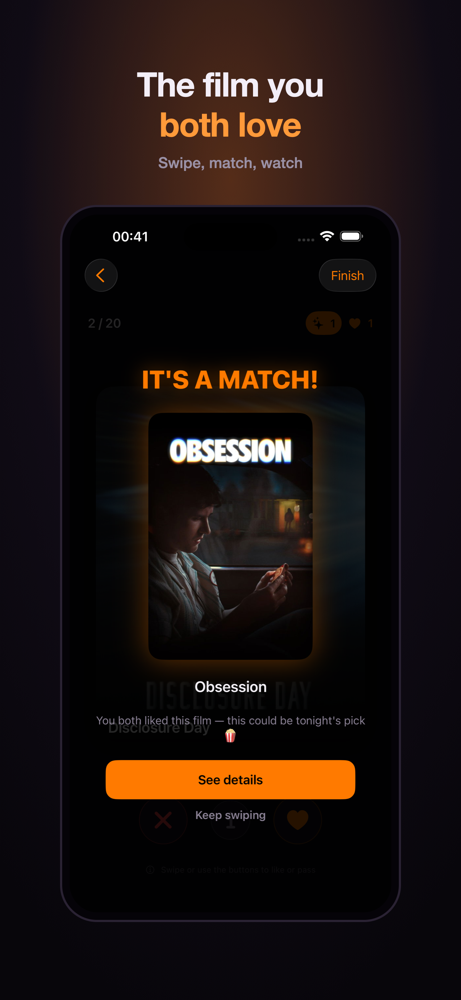
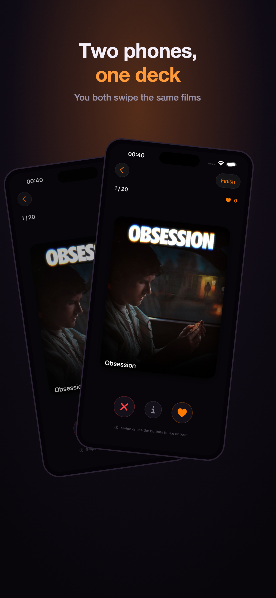
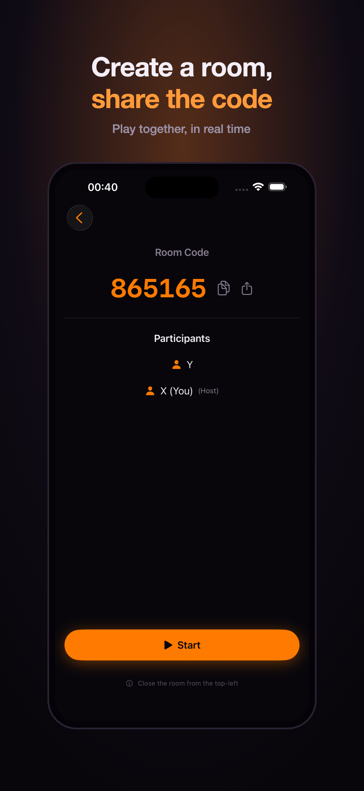
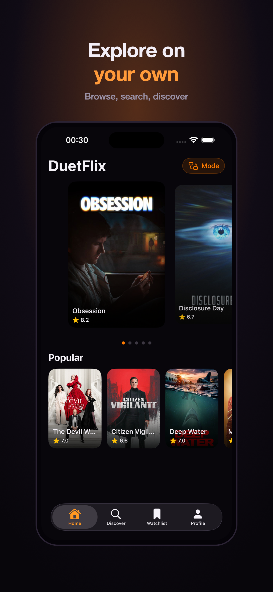
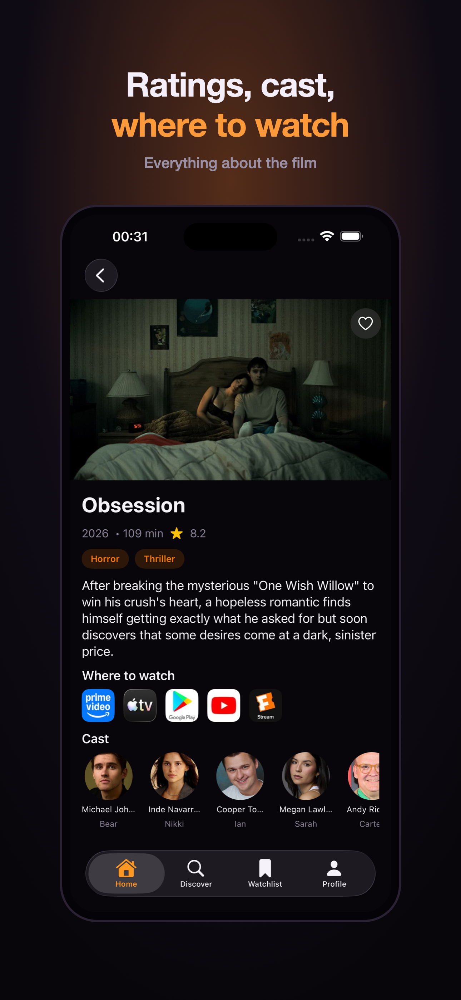
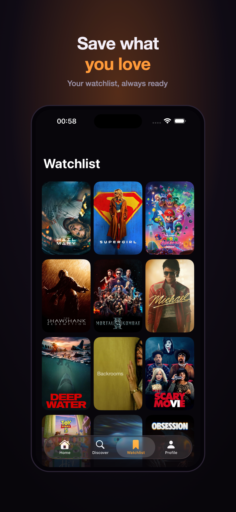
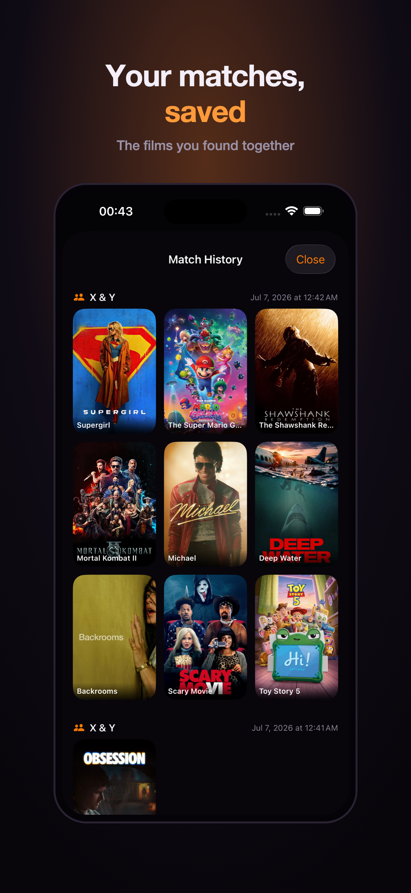

# DuetFlix

An iOS app for deciding what to watch tonight. Two people swipe through movie posters
and the app surfaces the films they **both** want to see — solving the endless
"what should we watch?" question.

Built with SwiftUI and MVVM as a portfolio project. A UmbraForge studio project.

[](https://swift.org)
[](https://developer.apple.com/ios/)
[](https://developer.apple.com/xcode/swiftui/)
[](https://firebase.google.com/)

## Screenshots

| | | | |
|:---:|:---:|:---:|:---:|
|  |  |  |  |
|  |  |  | |

## Features

### Duo mode
- Create a room and share a short code; the other person joins with it
- Both players swipe the same deck of films independently
- Real-time matching via Firestore listeners — the moment both like a film,
  an "It's a match!" celebration appears on both phones at once
- Persistent match history grouped by session, with the partners and date
- Anonymous sign-in (Firebase Auth) — no account or personal data required

### Solo mode
- Featured carousel with a peek-and-scale effect and page indicators
- Infinite-scroll "Popular" row that loads additional TMDB pages on demand, with image prefetching
- Live search with a 300 ms debounce
- Detail screen with backdrop header, genre tags, cast, and "where to watch" providers
- Watchlist with local persistence via SwiftData (add or remove with a frosted-glass button)

### Across the app
- English and Turkish, switchable in-app at any time (independent of the device language)
- Film titles and posters stay original; descriptions and genres follow the selected language
- VoiceOver labels on all controls; loading, empty, and error states throughout
- Dark, cinematic theme driven by design tokens
- Memory and disk image caching via Kingfisher

## Tech Stack

| Area | Choice |
|---|---|
| UI | SwiftUI (MVVM) |
| Concurrency | async/await, Task |
| Networking | URLSession with Codable, generic APIClient |
| Data source | [TMDB REST API](https://www.themoviedb.org/) |
| Real-time backend | Firebase Firestore + Anonymous Auth |
| Persistence | SwiftData (`@Model`, `@Query`) |
| Images | Kingfisher (caching and prefetch) |
| Localization | In-app manager with an EN/TR string table |
| Secrets | `.xcconfig` to Info.plist to AppConfig (keys are never committed) |

## Architecture

MVVM with a clear separation of layers:

```
Views  ── uses ──▶  ViewModels  ── calls ──▶  Services  ──▶  APIClient / Firestore
(SwiftUI)           (@Observable,             (TMDBService,             (generic
                     @MainActor)               RoomService,              fetch<T>)
                                               AuthService)
                                                      │
                                                Models (Codable / @Model)
```

- Views render state and forward user intent; they contain no business logic.
- ViewModels (`@Observable`, `@MainActor`) own screen state (loading / loaded / error).
- Services hide which endpoint or collection is called; a `TMDBService` protocol enables mocking.
- A single generic `fetch<T: Decodable>(url:)` in `APIClient` is reused by every endpoint
  (Bearer auth, status validation, and error mapping).
- Duo matching is a set intersection over each player's likes, kept in sync by Firestore snapshot listeners.

```
DuetFlix/
├─ App/          entry point (DuetFlixApp, RootView)
├─ Models/       Codable models and SwiftData @Model
├─ Services/     APIClient, TMDBService, RoomService, AuthService
├─ ViewModels/   @Observable screen logic
├─ Views/        SwiftUI screens and Components
├─ Resources/    Theme (design tokens), Assets
└─ Utilities/    AppConfig (secrets), LocalizationManager
```

## Getting Started

### Requirements
- Xcode 16 or later
- A free [TMDB API key](https://www.themoviedb.org/settings/api) (v3 key and v4 Read Access Token)
- A Firebase project with Firestore and Anonymous Auth enabled (for Duo mode)

### Setup
1. Clone the repository.
2. Create `Config/Secrets.xcconfig` with your TMDB credentials:
   ```
   TMDB_API_KEY = your_v3_key_here
   TMDB_ACCESS_TOKEN = your_v4_token_here
   ```
   `Secrets.xcconfig` is git-ignored. Keys are injected into Info.plist at build time and read via `AppConfig`.
3. Add your `GoogleService-Info.plist` from Firebase (also git-ignored).
4. Open `DuetFlix.xcodeproj` and run.


## Attribution

This product uses the TMDB API but is not endorsed or certified by TMDB.
