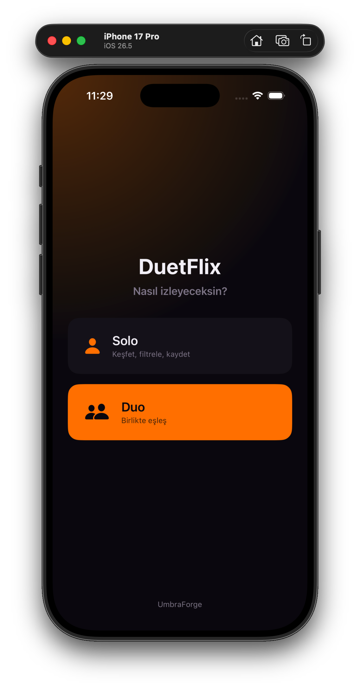
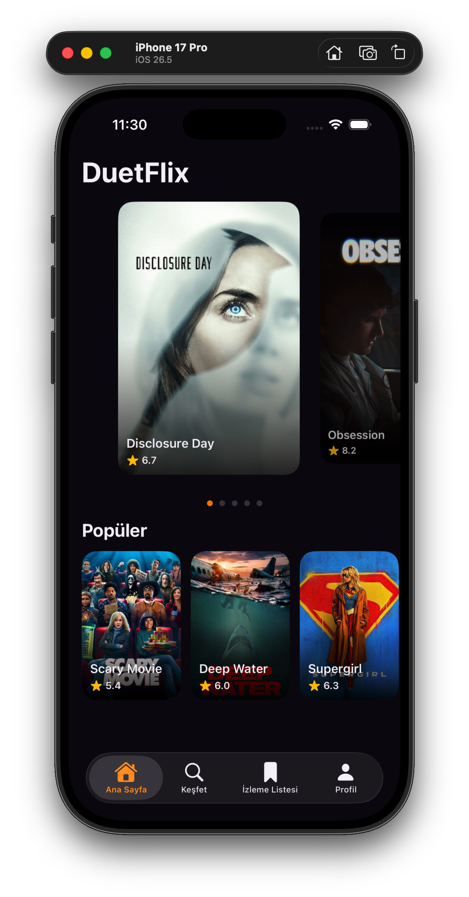
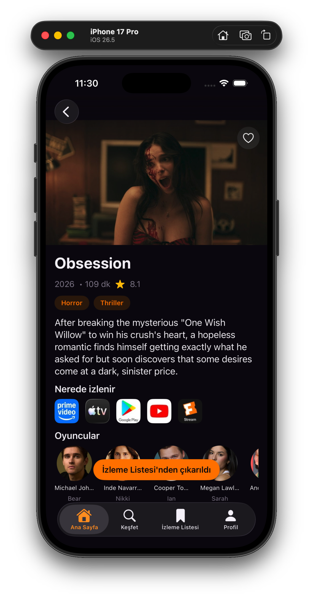
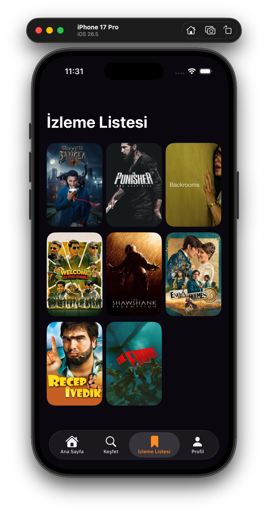
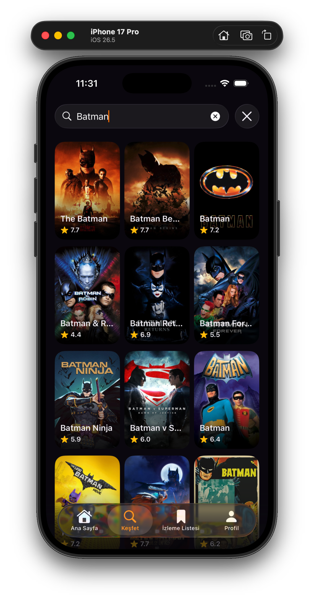

# DuetFlix

An iOS app for deciding what to watch tonight. Two people swipe through movie posters
and the app surfaces the films they **both** want to see — solving the endless
"what should we watch?" question.

Built with SwiftUI and MVVM as a portfolio project. A UmbraForge studio project.

[](https://swift.org)
[](https://developer.apple.com/ios/)
[](https://developer.apple.com/xcode/swiftui/)

## Screenshots

| Mode Select | Home | Detail | Watchlist |
|:---:|:---:|:---:|:---:|
|  |  |  |  |

<div align="center">

</div>

## Features

### Solo mode (implemented)
- Featured carousel with a peek-and-scale effect and page indicators
- Infinite-scroll "Popular" row that loads additional TMDB pages on demand, with image prefetching
- Live search with 300 ms debounce
- Detail screen with backdrop header, genre tags, cast, and "where to watch" providers
- Watchlist with local persistence via SwiftData (add/remove with a frosted-glass button)
- Dark, cinematic theme driven by design tokens
- Memory and disk image caching via Kingfisher

### Duo mode (planned)
Real-time matching: create or join a lobby, both users swipe a shared deck, and the app
reveals the movies they both liked (Firebase Firestore and Auth).

## Tech Stack

| Area | Choice |
|---|---|
| UI | SwiftUI (MVVM) |
| Concurrency | async/await, Task |
| Networking | URLSession with Codable, generic APIClient |
| Data source | [TMDB REST API](https://www.themoviedb.org/) |
| Persistence | SwiftData (`@Model`, `@Query`) |
| Images | Kingfisher (caching and prefetch) |
| Secrets | `.xcconfig` to Info.plist to AppConfig (keys are never committed) |

## Architecture

MVVM with a clear separation of layers:

```
Views  ── uses ──▶  ViewModels  ── calls ──▶  Services  ──▶  APIClient  ──▶  TMDB
(SwiftUI)           (@Observable,             (TMDBService              (generic
                     @MainActor)               protocol + Live)          fetch<T>)
                                                      │
                                                Models (Codable)
```

- Views render state and forward user intent; they contain no business logic.
- ViewModels (`@Observable`, `@MainActor`) own screen state (loading / loaded / error).
- Services hide which endpoint is called; a `TMDBService` protocol enables mocking and testing.
- A single generic `fetch<T: Decodable>(url:)` in `APIClient` is reused by every endpoint
  (Bearer auth, status validation, and error mapping).

```
DuetFlix/
├─ App/          entry point (DuetFlixApp, RootView)
├─ Models/       Codable models and SwiftData @Model
├─ Services/     APIClient, TMDBService
├─ ViewModels/   @Observable screen logic
├─ Views/        SwiftUI screens and Components
├─ Resources/    Theme (design tokens), Assets
└─ Utilities/    AppConfig (secrets access)
```

## Getting Started

### Requirements
- Xcode 16 or later
- A free [TMDB API key](https://www.themoviedb.org/settings/api) (v3 key and v4 Read Access Token)

### Setup
1. Clone the repository.
2. Create `Config/Secrets.xcconfig` with your TMDB credentials:
   ```
   TMDB_API_KEY = your_v3_key_here
   TMDB_ACCESS_TOKEN = your_v4_token_here
   ```
   `Secrets.xcconfig` is git-ignored. Keys are injected into Info.plist at build time and read via `AppConfig`.
3. Open `DuetFlix.xcodeproj` and run.

## Roadmap

- [x] Phase 1 — Solo (discover, search, detail, watchlist)
- [ ] Phase 2 — Duo (lobby, shared deck, live matching via Firebase)
- [ ] Phase 3 — Polish (localization, WidgetKit, unit tests, share)

## Attribution

This product uses the TMDB API but is not endorsed or certified by TMDB.
